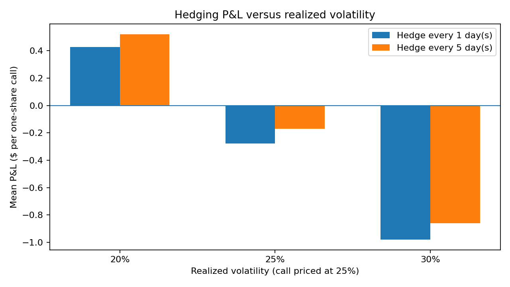
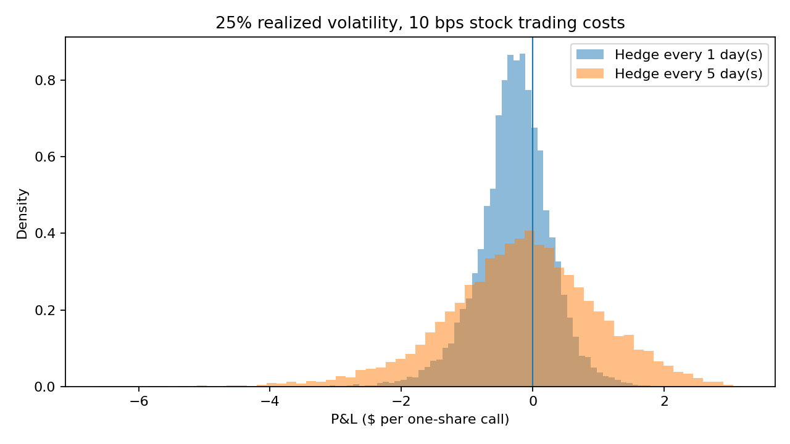

# Monte Carlo Options Hedging & Risk Simulator

An **educational, synthetic-data** study of how delta-hedging frequency affects the risk and transaction-cost trade-off for a short European call option.

## Research question

For a short European call, does rebalancing the stock delta hedge more frequently reduce risk enough to justify higher transaction costs? How does realized volatility change that trade-off?

## Assumptions

- $100 initial stock price; $100 strike; one call on **one share** for easier arithmetic (not a standard exchange-listed 100-share contract)
- 30 trading days to expiration; 252 trading days per year
- Volatility used to price and hedge the call: 25% annually
- Realized volatility: 20%, 25%, and 30%
- 10,000 risk-neutral geometric Brownian motion paths, using random seed 2027
- Hedging every 1 day, every 5 days, or only at inception
- Stock trading cost: 0 or 10 basis points, including entry, rebalancing, and final liquidation
- Zero interest and dividend yield

## Results

With realized volatility of 25% and 10 bps trading costs:

| Policy | Mean P&L per option | Std. deviation | Worst 5% average P&L |
|---|---:|---:|---:|
| Daily hedge | -$0.278 | $0.550 | -$1.594 |
| Hedge every 5 days | -$0.171 | $1.164 | -$2.905 |
| Initial hedge only | -$0.120 | $2.607 | -$6.805 |

The figures show **lower P&L dispersion** with more frequent hedging, but also **higher fees** and worse average after-fee P&L in this scenario. These are **simulation results only**, not real trading performance.





## Run in Jupyter

1. **Standard local Jupyter / Google Colab:** Install packages if missing with `%pip install numpy pandas scipy matplotlib` in a notebook cell. In Google Colab these are generally preinstalled.
2. **JupyterLite (browser/WebAssembly), as used for this project:** Do **not** use PyPI `%pip install` for pandas. Use `!mamba install pandas scipy matplotlib` in a notebook cell if the libraries are missing. JupyterLite may reset packages across sessions.
3. Open **`Monte_Carlo_Options_Hedging.ipynb`**.
4. Click **Run → Run All Cells**.
5. See the table and figures, then inspect `results/simulation_summary.csv`.

This ZIP already contains demonstration outputs. To document your own run, replace the included notebook with your **downloaded, personally executed** notebook before uploading the project to GitHub.

The notebook is self-contained: it does **not** import `simulator.py`.

Or run the independent Python script:

```bash
pip install -r requirements.txt
python simulator.py
```

## Learn by changing the inputs

- Add 20 bps to the `COSTS_BPS` list and compare how the result changes.
- Try larger realized volatility than the quoted volatility and examine the P&L tail.
- Explain why delta hedging reduces first-order price exposure but cannot remove gamma or volatility risk.

## Limitations and transparency

This is a simplified model with simulated data, no real market prices, option bid–ask spreads, jumps, liquidity, margin or financing, or realistic transaction execution. It is **not** evidence of a profitable trading strategy. Code development used AI assistance; the project should be claimed in job applications only to the extent you can personally reproduce, explain, verify, and extend it.

## Visualizations

### P&L Distribution


### Volatility Sensitivity

